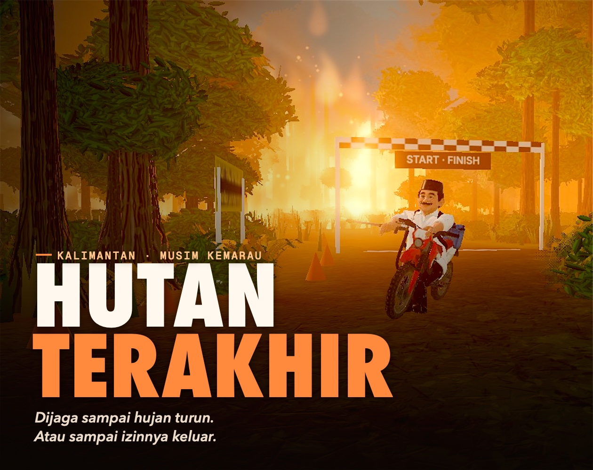
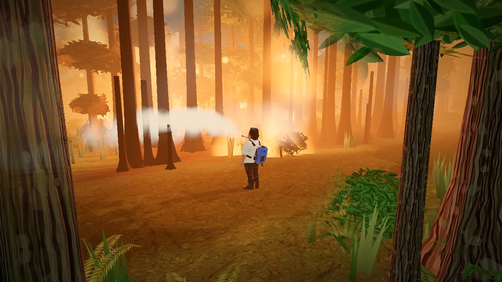
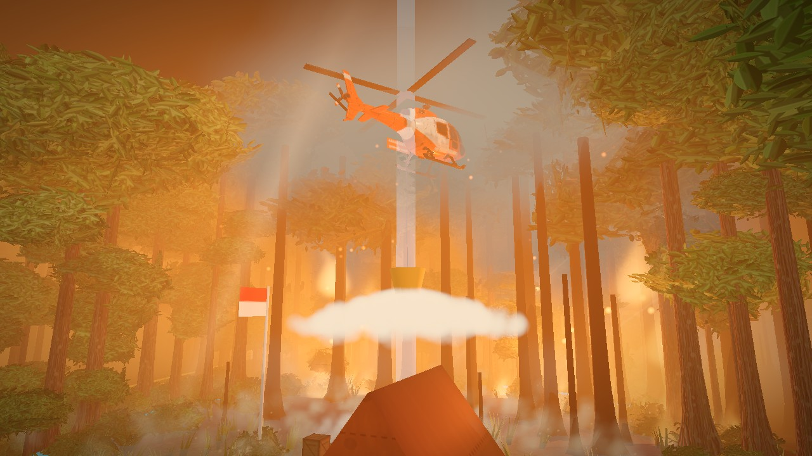
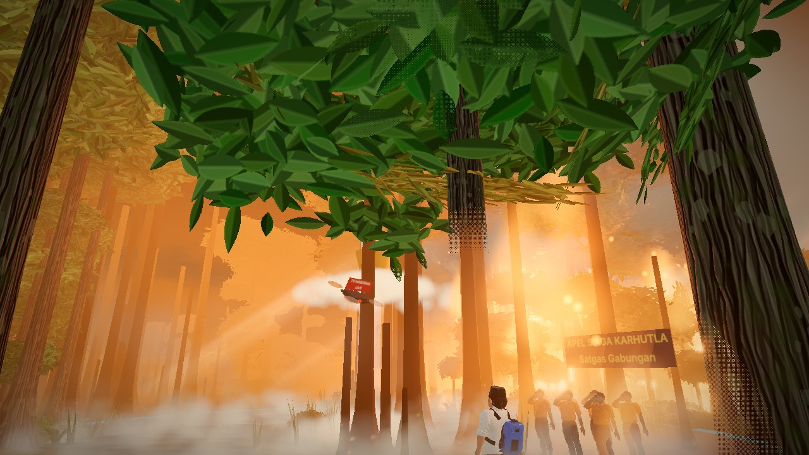
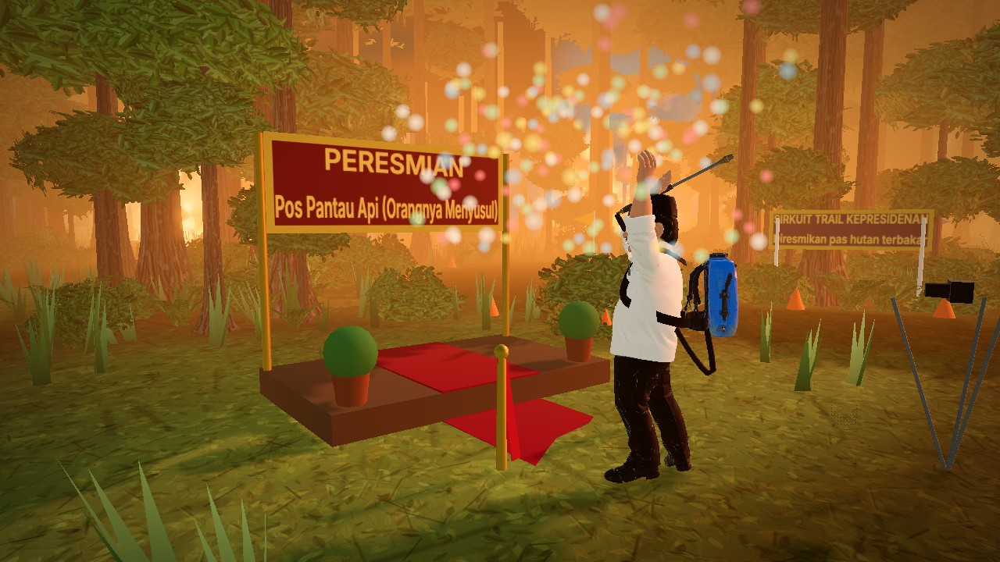
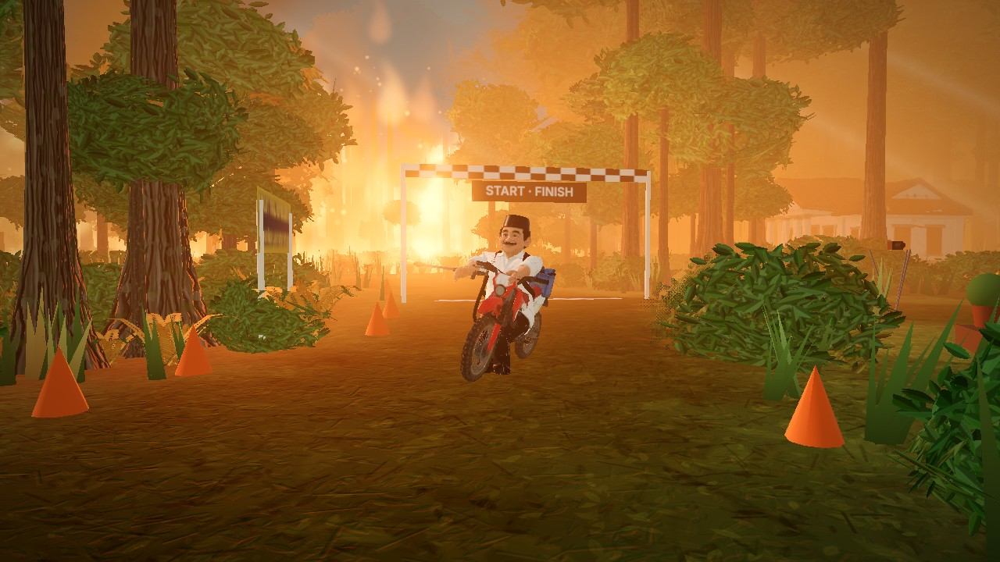

# Hutan Terakhir

> *Dijaga sampai hujan turun. Atau sampai izinnya keluar.*



Game 3D satir di browser soal kebakaran hutan dan lahan (karhutla) di Kalimantan.

Hutan terbakar. Kata pejabat: terkendali. Pak Presiden turun sendiri: madamin api, nangkep tikus berdasi, nyegel bulldozer, bawa bukti ke pengadilan, terus bertahan sampai hujan turun. Main ±7 menit, ada 3 ending.

Atau gunting pita dulu. Sirkuitnya juga udah jadi.

**▶ Main sekarang:** [after9to5build.itch.io/hutan-terakhir](https://after9to5build.itch.io/hutan-terakhir)

## Screenshot

| | |
|---|---|
|  |  |
|  |  |



## Kontrol

| | Keyboard | Controller |
|---|---|---|
| Jalan | WASD | Stik kiri |
| Lari | Shift | LT |
| Siram | Spasi | RT |
| Aksi (naik motor, borgol, segel, gunting pita) | E | A |
| Lempar jaring / Nasi MBG | Q (ganti: Z / C) | X (ganti: D-pad ◀ ▶) |
| Teriak | T | RB |
| Peta (kirim damkar / heli) | M | Y |
| Panggil motor | B | D-pad ▼ |
| Kamera | Seret mouse | Stik kanan |

Paling enak dimainin pakai controller. Kalau suaranya gak bunyi, klik layar sekali.

## Jalanin sendiri

Butuh [Node.js](https://nodejs.org) versi 18 ke atas.

```bash
npm install
npm run dev
```

Buka `http://localhost:5173`. Buat bikin versi rilis:

```bash
npm run build
```

Hasilnya ada di folder `dist/`. Zip isi folder itu kalau mau diupload ke itch.io (`vite.config.js` udah pakai alamat relatif).

## Isi repo

| Folder / file | Isi |
|---|---|
| `src/` | Kode game (Three.js + Vite, JavaScript biasa). Angka keseimbangan & jadwal di `src/levels.js` |
| `public/models/` | Model 3D (`.glb`). Kalau gagal dimuat, game pakai bentuk kotak cadangan |
| `public/audio/` | Rekaman suara. Kalau gak ada, game pakai suara sintetis dari kode |
| `tools/` | Skrip kecil: kompres model & rapihin rekaman suara |
| `docs/` | Cover & screenshot |

## Dibuat pakai

- [Three.js](https://threejs.org) + [Vite](https://vitejs.dev)
- [Claude Code](https://claude.com/claude-code) buat bantu nulis kode
- [Meshy](https://www.meshy.ai) buat model 3D, animasi dari [Mixamo](https://www.mixamo.com)
- Pohon, semak, api, asap, dan suara latar dibikin langsung dari kode

## Fakta di layar akhir

Game ini fiksi, tapi fakta di layar akhirnya asli dan ada sumbernya:

- Walhi: 74% titik panas di Kalimantan (Jan–Jul 2026) ada di area berizin perusahaan. [Mongabay](https://mongabay.co.id/2026/08/06/ketika-kebakaran-hutan-dan-lahan-menggila-di-kalimantan/)
- Rinciannya: 10.739 titik di kebun sawit, 7.880 di tambang, 6.905 di izin hutan. [NU Online](https://www.nu.or.id/nasional/34-262-titik-api-kepung-kalimantan-65-persen-di-kalbar-wqPjN)
- Pantau Gambut & Madani: kebun monokultur skala besar salah satu biang karhutla 2025. Cuaca bukan satu-satunya alasan. [Green Network](https://greennetwork.id/?p=10444)
- Warga Palangka Raya menggugat pemerintah soal karhutla 2015 dan menang sampai kasasi (2019). Tahun 2022, MA membaliknya lewat PK. [EmitenNews](https://www.emitennews.com/news/kasus-karhutla-kalteng-ma-menangkan-presiden-para-penggugat-prihatin)

## Disclaimer

**Karya fiksi & satire.** Semua tokoh, lembaga, perusahaan, dan kutipan di game ini fiktif. "Pak Presiden" adalah karakter generik, bukan tokoh asli mana pun. Kemiripan dengan orang, lembaga, atau perusahaan nyata gak disengaja.

## Lisensi & ketentuan

- **Kode:** [MIT](LICENSE). Bebas dipakai, diubah, dan dibagikan.
- **Aset** (rekaman suara, model 3D, cover, screenshot, nama game, identitas pembuat): **gak termasuk MIT**. Baca [LICENSE-ASSETS.md](LICENSE-ASSETS.md).

**Mau modif atau publish ulang?** Boleh, dengan syarat:

1. **Ganti suara.** Rekaman suara teriak itu suara asli pembuat, jadi wajib diganti pakai suara lo sendiri. Efek suara pihak ketiga juga wajib diganti.
2. **Ganti identitas.** Atribut pribadi pembuat (nama, akun, link) diganti pakai identitas lo sendiri, biar gak ada kesan versi resmi.
3. **Wajib kasih credit** di halaman publikasi **dan** di dalam game: *"Berbasis **Hutan Terakhir** oleh **after9to5build** · https://github.com/after9to5build/hutan-terakhir"*. Credit ini gak boleh dihapus atau diganti.
4. **Tulis jelas bahwa itu versi modifikasi**, bukan versi resmi.
5. **Tetap pertahankan disclaimer satir**, fakta yang akurat dan bersumber, dan jangan pakai wajah, nama, atau suara tokoh asli.

**Tanggung jawab:** pembuat cuma bertanggung jawab atas versi resmi (repo ini dan halaman itch.io resmi). Versi modifikasi sepenuhnya tanggung jawab yang memodif dan mempublishnya.

---

*English: a satirical 3D browser game about forest fires in Kalimantan, Indonesia. Code is MIT-licensed; assets, the author's voice, and identity are not. Forks must replace the audio and the author's personal attributes, clearly state they are unofficial, and credit the original both on their page and in-game: "Based on Hutan Terakhir by after9to5build · https://github.com/after9to5build/hutan-terakhir". See [LICENSE-ASSETS.md](LICENSE-ASSETS.md).*
